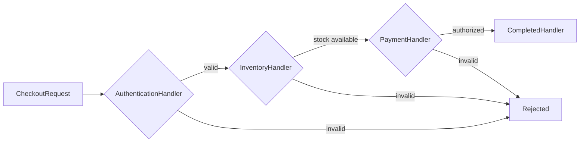

# Bolivar Design Patterns — Java 21

> **Hands-on design patterns study lab.** A growing Java repository for learning, implementing, testing and comparing Gang of Four (GoF) design patterns. Each pattern lives in a dedicated package with runnable examples and focused tests. The first pattern is **Chain of Responsibility**.

[](https://github.com/bolivarmardegan/design-patterns-java/actions/workflows/ci.yml)

## Purpose

Move beyond pattern definitions: implement each pattern from scratch, identify the problem it solves, explore trade-offs, inspect runtime behavior with breakpoints, and test edge cases. These samples are intentionally small and self-contained: no credentials, no AWS accounts, no real payment integrations.

## Pattern catalog

| Category | Pattern | Status | Demo |
|---|---|---|---|
| Behavioral | Chain of Responsibility | **Implemented** | Checkout validation (authentication → inventory → payment → completion) |
| Behavioral | Strategy, Observer, Command | Planned | Independent packages |
| Creational | Factory Method, Builder | Planned | Independent packages |
| Structural | Adapter, Decorator | Planned | Independent packages |

## Chain of Responsibility

### Intent

Pass a request through a chain of handlers. Each handler either handles the request and stops or delegates to the next handler. This sample uses **ordered validation (fail-fast)**: each handler checks a condition and passes only successful requests downstream.

### Problem

An e-commerce checkout needs ordered authentication, inventory and payment checks. One monolithic `if` sequence mixes responsibilities, is harder to reorder and harder to test independently. The chain isolates steps and lets the client depend only on `CheckoutHandler`.

### Execution path



**Note:** Payment is simulated by an input boolean; this is not a real payment gateway and is not a security/authentication implementation. Inventory is also simulated by request fields; this example does not reserve stock transactionally.

### Project structure

```text
src/
  main/java/dev/bolivar/designpatterns/
    behavioral/chainofresponsibility/
      CheckoutRequest.java
      Decision.java
      CheckoutHandler.java
      AbstractCheckoutHandler.java
      AuthenticationHandler.java
      InventoryHandler.java
      PaymentHandler.java
      CompletedHandler.java
      CheckoutChain.java
      CheckoutDemo.java
  test/java/dev/bolivar/designpatterns/
    behavioral/chainofresponsibility/CheckoutChainTest.java
```

### Requirements

- Java 21+
- Maven 3.9+ (recommended)

### Run locally

```bash
mvn clean test
mvn -q -DskipTests compile exec:java -Dexec.mainClass=dev.bolivar.designpatterns.behavioral.chainofresponsibility.CheckoutDemo
```

Expected results: the valid checkout is approved; a request for six units with five available is rejected at the inventory step.

### Explain the code

1. `CheckoutRequest` — immutable data passed to each handler.
2. `CheckoutHandler` — common interface; the caller knows only `handle()`.
3. `AbstractCheckoutHandler` — stores the next handler and provides `forward()`.
4. `AuthenticationHandler` — refuses empty/unknown user identifiers (a placeholder, not real authentication).
5. `InventoryHandler` — validates quantity and stock availability.
6. `PaymentHandler` — checks a simulated authorization flag and a positive amount.
7. `CompletedHandler` — terminal handler that explicitly approves after every required check passes.
8. `CheckoutChain` — composition root that wires the chain, making order visible.

### Tests

`CheckoutChainTest` covers approval, short-circuiting at each stage, zero quantity, invalid payment amount and reusing the chain. `SmokeTest` verifies construction. GitHub Actions runs `mvn verify` on every push and PR.

### Trade-offs

- **Benefits:** Single Responsibility, Open/Closed extension, configurable order, small independent tests.
- **Costs:** Hidden execution flow if the order is not explicit; debugging across handlers; risk of unhandled requests if no terminal/default behavior is defined.
- **Not for:** a fixed single operation where a normal function call is clearer.

### Suggested exercises

- Add `FraudCheckHandler` and new tests.
- Add diagnostic tracing of handlers (without logging secrets).
- Compare fail-fast validation with the alternative **first matching handler wins** variant.
- Refactor the chain builder to accept configurable sets of checks.

## Learning resources

- [Refactoring.Guru — Chain of Responsibility](https://refactoring.guru/design-patterns/chain-of-responsibility)
- [Refactoring.Guru — Java example](https://refactoring.guru/design-patterns/chain-of-responsibility/java/example)
- [Python `abc` standard documentation](https://docs.python.org/3/library/abc.html) (cross-language comparison)

## Companion Python implementation

[design-patterns-python](https://github.com/bolivarmardegan/design-patterns-python) — same scenario, same decision semantics, different language idioms.

## License

MIT. See [LICENSE](LICENSE).
